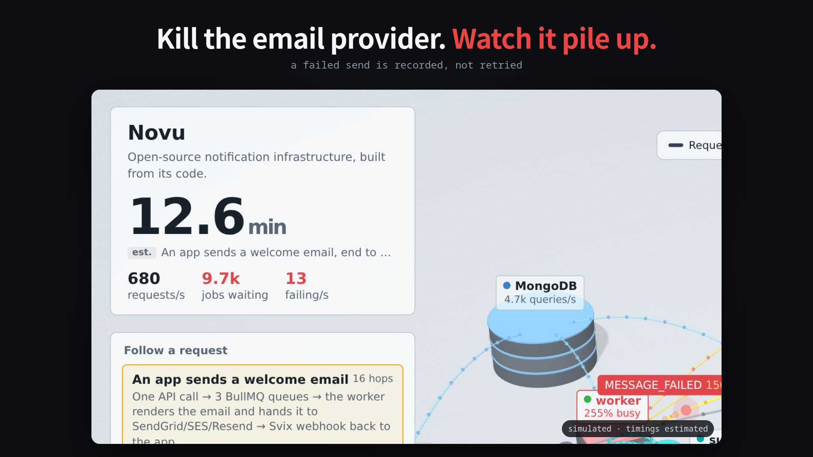

# Novu, x-rayed

A live 3D simulator of [Novu](https://github.com/novuhq/novu)'s notification pipeline, built from its open-source code.

**▶ Open the simulator: https://niyatinehal.github.io/novu-xray/**

## What you can do

- **Follow a request**: one welcome email travels API → 3 BullMQ queues → worker → email provider → Svix webhook (16 hops). Use ← → to step, space to pause, F to ride along with the camera.
- **Push traffic**: drag Traffic up to 17× and watch the `standard` queue back up.
- **Take a provider down**: kill the email, SMS or webhook provider and watch the backlog and end-to-end time climb.
- **Inspect anything**: click a block or pipe to see the code behind each call, with its file and line.

## How honest is it?

- **From the code:** services, queues, flows and worker counts (200 per queue, 400 for WebSocket, from `libs/application-generic/src/config/workers.ts`). Every hop was checked against its `file:line` in Novu at commit `97c9462`.
- **Estimated:** latencies and traffic volume. They're labelled "est." on screen.

## Found along the way

If queueing a batch of subscribers fails, the batch is skipped, but the usage counter still counts it. Reported with a fix and a test: [novuhq/novu#13181](https://github.com/novuhq/novu/issues/13181).

---

Not affiliated with Novu. Novu is MIT-licensed open source; this is an independent visualisation of its public code.
